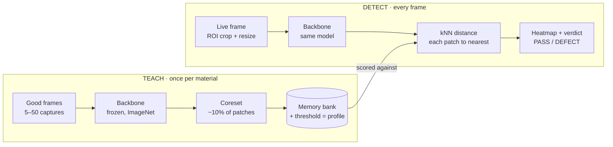

# PatchCore Web Demo — Software Spec

Oct 17, 2026 · Mike

## Overview

Build a static web app, hosted on GitHub Pages, that runs PatchCore anomaly detection entirely in the browser on a live camera feed. An operator teaches it a material from a handful of good samples in under a minute, then the app shows a live heatmap and a PASS / DEFECT verdict. It is a trade-show demo for composites defect detection (FOD, wrinkles, tow gaps and overlaps, resin-starved areas), not a production inspection system.

**Goals**

- Teach-then-detect entirely on the client: no server, no install, no cloud inference.
- Runs in Chrome/Edge on laptops, mini PCs, Chromebooks and Android phones, so the same URL can be benchmarked across hardware.
- Taught material profiles persist across sessions, can be switched from a dropdown, and can be exported and imported as files.
- Selectable backbone (light and accurate variants) and inference backend (WebGPU, WASM), with a built-in benchmark readout.
- Booth-friendly: full-screen display mode, large verdict, minimal operator interaction.

**Non-goals**

- Production-grade accuracy, validated detection rates, or traceability.
- Model fine-tuning or any backpropagation in the browser.
- User accounts, a backend, or cloud storage.
- Native Android/iOS apps.

**For Claude Code:** treat this document as the source of truth. Build in the milestone order at the end, keep each milestone runnable and deployed, and verify the browser math against the Python reference fixtures before moving to UI polish. Where this spec is silent, choose the simplest option and record the choice in `DECISIONS.md`.

## Architecture and deployment

The app is a single-page TypeScript app built with Vite and deployed from a public repository to free GitHub Pages by a GitHub Actions workflow on every push to `main`. All inference runs in the browser through ONNX Runtime Web; models and bundled profiles are static files served from the same Pages site.

**Stack**

| Layer | Choice | Notes |
| --- | --- | --- |
| Build | Vite + TypeScript (strict) | `base` set to the repo name for Pages paths |
| UI | Plain TS + lightweight components (Preact or Lit) | No heavy framework needed |
| Inference | `onnxruntime-web` | WebGPU execution provider first, WASM (SIMD, threads) fallback |
| Heavy compute | Web Worker | Inference, coreset and scoring never block the UI thread |
| Storage | IndexedDB (via `idb`) | Profiles and settings |
| Tests | Vitest (unit), Playwright (smoke) | Fixtures generated by the Python reference |
| Model tooling | Python 3.11, PyTorch, torchvision, `onnx`, `onnxruntime` | Lives in `/tools`, not shipped |

**GitHub Pages constraints the build must handle**

- Pages cannot set HTTP headers. Multithreaded WASM needs cross-origin isolation (COOP/COEP) for `SharedArrayBuffer`, so include a service-worker shim (`coi-serviceworker` pattern) and fall back to single-threaded WASM if isolation is not active.
- HTTPS is provided by Pages, which satisfies `getUserMedia` and WebGPU secure-context requirements.
- Pages rejects files over 100 MB. Ship backbones as FP16 ONNX and keep each model file well under that limit; store model files with Git LFS only if needed (Pages does not serve LFS content, so prefer plain files).
- Copy the ONNX Runtime WASM binaries into the build output and set `ort.env.wasm.wasmPaths` so they load from the site, not a CDN.
- Models are cached by the service worker after first load so the booth demo keeps working if the venue Wi-Fi drops.

**Repository layout**

```
/
├─ index.html
├─ src/
│  ├─ main.ts              app shell, routing between modes
│  ├─ camera/              device enumeration, constraints, ROI
│  ├─ worker/              inference worker: ORT sessions, teach, score
│  ├─ patchcore/           coreset, threshold, heatmap post-processing
│  ├─ profiles/            IndexedDB store, export/import, bundled list
│  ├─ ui/                  operator, booth and benchmark views
│  └─ util/                timing, device info, logging
├─ public/
│  ├─ models/              backbone + distance ONNX files, models.json manifest
│  ├─ profiles/            bundled example profiles, profiles.json manifest
│  └─ brand/               accudyne-logo.png
├─ tools/
│  ├─ export_backbone.py   builds the ONNX models
│  ├─ reference.py         Python PatchCore reference + test fixtures
│  └─ requirements.txt
├─ tests/                  Vitest + Playwright
├─ .github/workflows/pages.yml
├─ DECISIONS.md
└─ README.md
```

## Model export pipeline

A Python script in `/tools` exports each backbone as one ONNX graph that takes an image and returns PatchCore patch features ready for scoring, plus a small separate graph for nearest-neighbor distance. Pushing preprocessing and feature aggregation into the graph keeps the browser code thin and guarantees the browser matches the Python reference.

**Backbone graph (`backbone_<id>_<size>.onnx`)**

1. Input: `image` float32 `[1, 3, H, W]`, RGB, values 0–1. H = W = the model's input size.
2. In-graph ImageNet normalization (mean/std).
3. Torchvision ImageNet-pretrained backbone, truncated after layer 3. Weights are frozen and never change.
4. Take layer 2 and layer 3 outputs. Apply 3×3 average pooling (stride 1, padding 1) to each, which is PatchCore's local neighborhood aggregation.
5. Bilinearly upsample layer 3 to layer 2's spatial size and concatenate on channels.
6. If the concatenated dimension exceeds the target D, apply a fixed random projection matrix (seeded, stored as a graph constant) down to D.
7. Output: `features` float32 `[N, D]`, where N = (H/8) × (W/8), row-major over the feature grid.

**Backbones to export**

| id | Torchvision model | Layer 2 + 3 channels | Output D | Input sizes | Role |
| --- | --- | --- | --- | --- | --- |
| `r18` | `resnet18` | 128 + 256 | 384 (no projection) | 224, 320 | Default; phones and low-end laptops |
| `wrn50` | `wide_resnet50_2` | 512 + 1024 | 512 (projected) | 224, 320 | Higher quality; laptops with WebGPU |

Export each as a separate static-shape file per input size (WebGPU performs best with static shapes). Use opset 17. Export FP32; also try an FP16-weight variant of `wrn50` and keep it only if it loads and matches the reference within tolerance. Every file must stay under GitHub Pages' 100 MB limit. A MobileNetV3 or EfficientNet-B0 variant is a stretch goal for very weak devices.

**Distance graph (`knn.onnx`)**

- Inputs: `features` `[N, D]`, `bank` `[M, D]`, `bank_sqnorm` `[M]`, all with dynamic N and M.
- Computes squared Euclidean distance as ‖f‖² − 2·f·bᵀ + ‖b‖², clamps at 0, takes the minimum over M, then the square root.
- Output: `min_dist` `[N]`.
- The worker calls it in bank chunks (default 4,096 rows) and takes the running minimum, which bounds GPU memory on phones.
- A plain TypeScript implementation of the same math is kept as a reference and CPU fallback.

**Manifest (`public/models/models.json`)**

One entry per file: `id`, display name, file path, input size, feature grid size, D, file SHA-256, and export version. Profiles record the backbone id, input size and hash they were taught with, and the app refuses to score a profile against a mismatched backbone.

**Reference and fixtures (`tools/reference.py`)**

- Implements the full pipeline in Python: feature extraction (run through both PyTorch and the exported ONNX), greedy coreset, kNN scoring, threshold and heatmap.
- Asserts ONNX output matches PyTorch within 1e-3 max absolute error.
- Generates test fixtures into `tests/fixtures/`: input images, feature tensors, coreset indices for a fixed seed, score maps and image scores.
- Uses procedurally generated woven-texture images with planted defects (a dropped tow, a foreign patch, a wrinkle-like distortion), so no third-party dataset licensing is involved.

## Teach and detect

Teaching takes 5–50 good images, extracts their patch features, keeps a representative subset as the memory bank, and sets a threshold from held-out good images; detection scores each live frame against that bank. No weights are trained, so teaching should finish in seconds.



The same frozen backbone serves both paths; only the memory bank and threshold change between materials, which is why profiles are small and switch instantly.

**Teach**

1. Operator picks backbone and input size (default `r18` @ 224), names the profile, and starts teaching.
2. Capture good frames: manual "Capture" button, or auto-capture every 0.5 s while the operator repositions the sample. Default 15 frames, minimum 5, maximum 50. Show thumbnails with a delete control for bad captures.
3. Each frame: crop to the ROI, resize to the input size, run the backbone, append the `[N, D]` features to a teach buffer.
4. Hold out the last 20% of frames (at least 2) for calibration; they are not added to the bank.
5. Coreset: greedy k-center selection as in the PatchCore paper. Compute selection distances on a seeded random projection to 128 dims for speed, keep the selected rows at full D. Target size = 10% of teach patches, clamped to 1,000–10,000 rows. Run in the worker with a progress bar.
6. Store the bank and its precomputed squared norms.
7. Score each held-out frame (detection steps below). Threshold = highest held-out image score × margin, default margin 1.15, adjustable afterward with a slider. Also store the median held-out patch score as the heatmap floor.
8. Save the profile (see Profiles).

**Detect (per frame)**

1. Grab the newest camera frame; drop stale frames rather than queue them.
2. Crop to ROI, resize, run backbone → `[N, D]`, run kNN against the bank → `min_dist` `[N]`.
3. Reshape to the feature grid, bilinearly upsample to the ROI's display size, Gaussian blur with σ = 4 input pixels (PatchCore's standard smoothing).
4. Image score = maximum of the smoothed map.
5. Verdict with hysteresis to stop flicker: DEFECT after 2 consecutive frames above threshold, back to PASS after 3 consecutive frames below.
6. Overlay: color-mapped heatmap (Turbo colormap) scaled from the heatmap floor to 1.5 × threshold, transparent below the floor, with contour lines around regions above threshold.
7. Freeze-frame control holds the current result on screen for discussion with visitors.

**Deferred to later versions**

- PatchCore's density-based score reweighting (adds little for a demo).
- Tiled inference (2×2 tiles of the ROI) for small defects across a larger field of view.
- Light teach-time augmentation (small shifts) if handling variation proves to be a problem.

## Profiles

A profile is a taught material: its memory bank, threshold and the capture settings it was taught under. Profiles persist in IndexedDB across sessions, switch from a dropdown without reteaching, and move between devices as `.pcprof` files.

**Operations**

- Create (teach), rename, delete, duplicate.
- Switch: loads the bank into the worker; target under 1 s for a 5,000-row bank.
- Re-threshold: change the margin without reteaching.
- Add good images: append captures to an existing profile and recompute the coreset. This is the fix for false alarms found on the show floor.
- Export to `.pcprof` file (download) and import from file (file picker or drag-and-drop).
- Bundled profiles: listed in `public/profiles/profiles.json`, loaded read-only, can be duplicated into local storage.

**`.pcprof` file format (little-endian)**

| Offset | Field | Type |
| --- | --- | --- |
| 0 | Magic `PCPF` | 4 bytes |
| 4 | Format version (1) | uint32 |
| 8 | Header length L | uint32 |
| 12 | Header | UTF-8 JSON, L bytes, padded to 4-byte alignment |
| after header | Memory bank | float32 or float16 `[M, D]` |
| after bank | Squared norms | float32 `[M]` |
| after norms | Thumbnail | JPEG bytes, length in header |

Header fields: `name`, `notes`, `created`, `appVersion`, `backboneId`, `inputSize`, `modelSha256`, `D`, `M`, `bankDtype`, `threshold`, `margin`, `heatFloor`, `roi` (normalized x, y, w, h), `camera` (device label, resolution, and any locked exposure, focus and white-balance values), `rig` (free-text name of the hardware setup), and `teachStats` (frame count, held-out scores).

**Compatibility rules**

- Refuse to load a profile whose `modelSha256` does not match an available backbone; say which backbone it needs.
- Warn, but allow, when the current camera or rig differs from the profile's. A profile is only valid under the lighting and camera it was taught with.

## Camera and capture

The app uses any camera the browser exposes, with an external USB (UVC) webcam on a fixed rig as the primary target, and locks exposure, focus and white balance after setup so the image stays consistent between teaching and detecting.

**Sources**

- Camera: `navigator.mediaDevices.enumerateDevices()` → device picker listing every video input; remember the last choice in settings. Request 1280×720 by default with 1920×1080 selectable.
- Image files: load a folder or set of images for teaching and testing without a camera. Required for development and automated tests.
- Video file: optional source for repeatable demos and benchmarking.

**Camera controls**

- Read `track.getCapabilities()` and show controls only for what the camera supports: exposure mode and time, focus mode and distance, white-balance mode and color temperature, brightness, zoom, and torch on phones.
- "Lock" button: switch each supported control from auto to manual at its current value. Show clearly which controls could not be locked on this device.
- Save the locked values in the profile and reapply them when the profile loads.
- No mirroring of the preview.

**Region of interest**

- A draggable, resizable square over the preview (the backbone input is square). Default: centered, 80% of the shorter side.
- Stored as normalized coordinates in the profile.

**Frame path**

- `createImageBitmap(video, crop…, {resizeWidth, resizeHeight, resizeQuality: 'high'})` produces the cropped, resized frame, which is transferred to the worker without copying.
- The worker converts it to float32 CHW, 0–1, and runs inference.
- Only one frame is in flight at a time; the newest frame wins.

## User interface

The app has three modes: Operator for setup and teaching, Booth for the full-screen visitor display, and Benchmark for comparing hardware. Layout must work from a phone in portrait to a 1080p monitor in landscape.

**Operator mode**

- Source and camera picker, camera controls with Lock, ROI editor.
- Backbone, input size and execution provider (Auto, WebGPU, WASM) selectors.
- Profile dropdown with create, rename, duplicate, delete, export, import, re-threshold and add-images actions.
- Teach panel: capture button, auto-capture toggle, thumbnails with delete, progress through feature extraction, coreset and calibration.
- Live view: preview, heatmap overlay with opacity slider, image score against threshold as a small live chart, verdict.

**Booth mode**

- Full screen (Fullscreen API) with the Screen Wake Lock API so the display never sleeps.
- Live image with heatmap, a large PASS / DEFECT banner, the profile name, and a small footer showing device, backend and fps.
- Optional side-by-side: last good reference thumbnail next to the live view.
- Exits only by a long-press or keyboard shortcut, so visitors cannot change settings.
- Optional idle attract loop: after 60 s with no change in the scene, cycle through saved example detections.

**Branding**

- Accudyne logo in the Booth mode header and the Operator mode top bar, committed at `public/brand/accudyne-logo.png`. Source: the header logo on [accudyne.com](https://www.accudyne.com), at `https://www.accudyne.com/wp-content/uploads/2016/07/logo.png`. Claude Code downloads it during milestone 2.
- That web logo may be low-resolution for a large booth display; replace it with a high-resolution or vector (SVG) version from marketing when available, using the same file path.
- Page title "Accudyne Systems · Composite Defect Detection Demo"; favicon generated from the logo.
- Booth mode uses a dark, neutral background so the heatmap colors stay readable; logo colors are used for accents only.

**Benchmark mode**

- Runs a fixed workload against bundled test images: model load time, first-inference warm-up time, then 50 timed frames per backbone, input size and execution provider combination.
- Reports per-stage medians and 95th percentiles (preprocess, backbone, kNN, post-process, end-to-end fps), plus device info: user agent, WebGPU adapter info when available, logical core count, cross-origin isolation status.
- Results are shown as a table and downloadable as JSON, with a one-click copy for pasting into a comparison sheet.

**Diagnostics (all modes)**

- A collapsible panel shows the active backend, whether threads are enabled, model hashes, and the last error. Errors are human-readable, such as "WebGPU not available on this device, using WASM".

## Targets, testing and delivery

The build is done when a person can open the Pages URL on a laptop with a USB webcam, teach a material in under a minute, and see a stable, correct verdict on planted defects. The performance figures below are targets to measure with Benchmark mode, not guarantees.

**Performance targets**

| Device class | Configuration | End-to-end target |
| --- | --- | --- |
| Laptop with WebGPU | `r18` @ 224 | ≥ 10 fps |
| Laptop with WebGPU | `wrn50` @ 320 | ≥ 3 fps |
| Recent mid-range Android phone | `r18` @ 224 | ≥ 3 fps |
| Any supported device, WASM only | `r18` @ 224 | ≥ 1 fps |

Teaching 15 frames with `r18` @ 224 should finish in under 15 s on a laptop. Profile switching should take under 1 s.

**Testing**

- Unit tests (Vitest): kNN, coreset and threshold math against the Python fixtures; `.pcprof` round-trip; hysteresis logic.
- Model parity: backbone features from ONNX Runtime Web (WASM) match the fixture features within 1e-3 max absolute error.
- End to end (Playwright, Chromium, WASM backend, fake camera fed from fixture images): teach on good images, then the planted-defect images are flagged DEFECT and good held-out images PASS.
- CI runs unit and end-to-end tests before deploying to Pages.

**Acceptance criteria**

- [ ] Deployed at the repo's GitHub Pages URL, loads with no console errors in current Chrome and Edge.
- [ ] Works offline after first load.
- [ ] Falls back from WebGPU to WASM automatically and says so.
- [ ] Teach, detect, switch, export and import profiles all work, and profiles survive a browser restart.
- [ ] On fixture images, every planted defect is flagged and no good held-out image is flagged.
- [ ] Booth mode runs for 8 hours without memory growth or a sleeping screen.
- [ ] Benchmark mode produces a downloadable JSON report.

**Milestones (build in this order, each deployed)**

1. Python tooling: export `r18` and `knn.onnx`, reference implementation, fixtures.
2. Skeleton site on Pages: Vite, worker, ORT loading on WebGPU and WASM, COOP/COEP shim, model manifest, diagnostics panel, branding assets.
3. Image-file source plus teach and detect pipeline; parity tests passing.
4. Live camera: device picker, ROI, camera controls with Lock.
5. Profiles: IndexedDB, switching, `.pcprof` export and import, bundled profiles.
6. Booth mode and Benchmark mode.
7. `wrn50` export and backbone switching; offline caching; polish.

**Open questions**

- Which composite materials and defect types should the first bundled profiles cover?
- Will the booth run on a laptop or mini PC with the webcam, or should Android phones with a USB webcam be a supported booth configuration? External UVC camera support on Android varies by phone and Android version.
- Resolved: the repo is public (free Pages). Keep secrets and customer-specific material out of it.
- Resolved: the demo uses Accudyne branding in Booth mode (see Branding under User interface).
